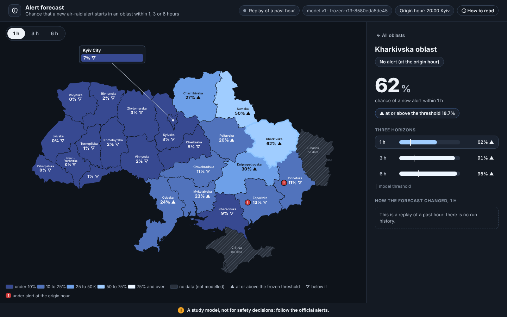

# Ukraine air-raid alerts: hourly forecast by oblast

An hourly estimate of the chance that a new air-raid alert starts in each Ukrainian oblast within the next 1, 3 or 6 hours, tested against simple rules and shown on a local map.

*Started as the selection task for KSE Agentic AI School, then extended independently.*



*A replay of 24 Aug 2026, 20:00 Kyiv time (`predict.py --at`, English page), Kharkivska selected. This is one hour shown as an illustration, not evidence of skill. Kharkivska at this hour, model next to the three simple rules: 1 h: model 62%, train frequency 25%, same hour yesterday no, same as now no, new alert followed: no; 3 h: model 91%, train frequency 66%, same hour yesterday no, same as now no, new alert followed: yes; 6 h: model 95%, train frequency 83%, same hour yesterday yes, same as now no, new alert followed: yes.*

## What it predicts, and why it is hard
At every hour, for each of the 24 regions (23 oblasts and Kyiv city, called oblasts here), the model gives a probability that a **new** alert starts within the next H hours, for H = 1, 3 and 6. It uses only what was known at that hour.

- **New alerts, not "is there an alert".** In the first test window, 67.5% of the hours with an alert in the next hour already had an alert running. Answering that is mostly reading the present, so the project forecasts the start of a new alert.
- **Alerts are bursty and rare in most places.** A new alert starts within the next hour in 12.1% of test oblast-hours (18.0% in the later forward test). A rule that says "the usual rate for this oblast at this hour" is already hard to beat on probabilities.
- **The alert history is all the model sees.** It has no view of launches or radar, so it can only learn patterns in when and where alerts have followed each other.
- **The data moves.** Between July and December 2025 the official system moved from whole-oblast alerts to raion-level alerts (the project counts an oblast as under alert when at least half of its raions are), and the official feed stopped on 2026-09-07, so newer data comes from the Ukraine Alarm API.

## Results
Within-oblast AUC / Brier for a new alert within H hours. The right column is the **best of the three simple rules** (train frequency, same hour yesterday, same as now), taken separately for each metric, with the rule's name: the best AUC and the best Brier can belong to different rules. The 0/1 rules (yesterday, now) give no probabilities, so their Brier scores are large by construction; they are used raw, with no threshold search.

| Test | H (hours) | Model: AUC / Brier | Best simple rule: best AUC / best Brier among the three |
|---|---|---|---|
| v1 test: official data, 24 days | 1 | 0.688 / 0.087 | 0.525 (yesterday) / 0.101 (frequency) |
|  | 3 | 0.645 / 0.145 | 0.581 (frequency) / 0.177 (frequency) |
|  | 6 | 0.639 / 0.140 | 0.612 (frequency) / 0.178 (frequency) |
| Forward test: frozen v1, API data, 41 days | 1 | 0.708 / 0.119 | 0.531 (frequency) / 0.152 (frequency) |
|  | 3 | 0.662 / 0.167 | 0.532 (yesterday) / 0.259 (frequency) |
|  | 6 | 0.654 / 0.143 | 0.536 (yesterday) / 0.256 (frequency) |
| v2: API data, 20 days | 1 | 0.692 / 0.127 | 0.517 (yesterday) / 0.165 (frequency) |
|  | 3 | 0.663 / 0.166 | 0.541 (yesterday) / 0.278 (frequency) |
|  | 6 | 0.664 / 0.131 | 0.543 (yesterday) / 0.238 (yesterday) |
| Round 22 development, v2 recipe retrained: official + API data, mean of 6 folds of 14 days | 1 | 0.664 / 0.093 | 0.526 (frequency) / 0.111 (frequency) |
|  | 3 | 0.615 / 0.146 | 0.542 (frequency) / 0.192 (frequency) |
|  | 6 | 0.605 / 0.137 | 0.542 (frequency) / 0.191 (frequency) |
| Round 22 development, v3 candidate (XGBoost, finer timing features): same 6 folds, mean | 1 | 0.697 / 0.091 | 0.526 (frequency) / 0.111 (frequency) |
|  | 3 | 0.651 / 0.145 | 0.542 (frequency) / 0.192 (frequency) |
|  | 6 | 0.619 / 0.136 | 0.542 (frequency) / 0.191 (frequency) |

- **Within-oblast AUC** is how well the model ranks risky hours above quiet ones inside one oblast: 0.5 is a coin flip, 1.0 is perfect. **Brier** is how close the probabilities are to what happened: lower is better. Plain accuracy is not used.
- **What the table says:** in every row the model has a better Brier score than the best simple rule and a higher AUC, but the AUC margin is modest and varies a lot between tests (from 0.027 to 0.177).
- **On the old test (v1, official data) the H = 6 advantage over the train frequency was not established:** 0.639 against 0.612 in AUC, the evidence does not separate that gap from chance (the Brier score at H = 6 is clearly better; see DETAILS). The forward test and v2 are different periods; they do not replace that finding.
- **The tests are separate and are not pooled.** The forward test, v2 and round 22 use other periods and a different source (the API), and frozen v1 was already scored on the days v2 is tested on.
- **Sep 4-5 on its own** (the last two days of the v1 test, where 7-day features are scaled from the observed hours because of the feed outage before them), next to the pooled v1 numbers above. Same hour yesterday ranks better than the model at every H on these two days:
  - H = 1: model 0.534 / 0.098, train frequency 0.466 / 0.119, same hour yesterday 0.538 / 0.218, same as now 0.359 / 0.365
  - H = 3: model 0.476 / 0.158, train frequency 0.424 / 0.218, same hour yesterday 0.519 / 0.297, same as now 0.395 / 0.425
  - H = 6: model 0.447 / 0.120, train frequency 0.409 / 0.203, same hour yesterday 0.501 / 0.196, same as now 0.392 / 0.444
- **Round 22 (an experiment, not a deployed model).** On six 2-week folds before 2026-09-28, each trained on everything before it, finer timing features (the oblast's own 10-minute activity, its raions, national counts) added +0.015 AUC [+0.0007, +0.0297, 95% day bootstrap] to the v2 recipe; features for massive events and for weather added nothing. XGBoost on the new features is the v3 candidate: +0.017 AUC [+0.0038, +0.0300] over the v2 recipe, mean over H, ahead in all six folds. The gain was +0.042 in the first fold and +0.004 in the last, the intervals are too kind (three groups and three models were tried on the same 84 days), and the window 2026-09-28 to 10-17 was not used for any choice. **v2 stays the default.** v3 is compared with v2 on data after 2026-10-19 by a rule written in advance ([DETAILS](docs/DETAILS.md#round-22-trying-to-improve-the-model-v3-candidate-development-only)).
- Thresholds for precision and recall come from the last train week, never from a test window. They, the confidence intervals over days and the calibration are in [DETAILS](docs/DETAILS.md#forward-test-on-the-ukraine-alarm-api) and in `results/`.

## How it works
- **Data:** the official alert history (Vadimkin/ukrainian-air-raid-sirens-dataset) up to 2026-08-28, then the Ukraine Alarm API archive, joined into one hourly table per oblast ([combined dataset](docs/DETAILS.md#the-combined-dataset-official-data--the-api-archive)).
- **Target:** a new alert starts within the next 1, 3 or 6 hours. An oblast is under alert when at least half of its raions are.
- **Features, all known at the forecast hour:** the oblast's own alert state and history (hours since the last alert, shares of time under alert over 6 h, 24 h and 7 d, recent starts), the neighbouring oblasts in the last completed hour, hour of day and weekday, and the rate for the same hour in the previous four weeks. A check script tries to break this ([no leakage](docs/DETAILS.md#model-scriptsevaluatepy-srcfeaturespy)).
- **Model:** one LightGBM per horizon for all 24 oblasts (v2 is trained on the combined data), trained and tested in time order (never a random split), with thresholds picked on the last train week.
- **Use:** `predict.py --now` forecasts the last completed hour from the live API, appends to an append-only prediction log and writes the map. An optional Telegram bot can message you when a watched oblast crosses a threshold ([alert bot](docs/DETAILS.md#the-alert-bot)).

## Limitations
- **It is a study model.** It is not an early-warning system and must not be used for safety decisions.
- **Ranking skill is modest,** and on the old test the AUC edge over the simple frequency rule at H = 6 was not established.
- **Probabilities run a little low** in the busier forward period; the model was fixed on quieter data and is not recalibrated.
- **The tests are short.** The v1 test is 24 days, the forward test 41, the v2 test 20 and the round 22 folds 84, each one period and the later ones from one source, so the intervals are wide.
- **The round 22 result is development only.** v3 was chosen on the same days it was compared on, and its gain fades in the newest fold; it has not been tested on new data.
- **Official data is incomplete.** The official feed had an outage from 2026-08-29 to 09-02, stopped on 2026-09-07 and missed one wave on Aug 19-20. The combined dataset takes the API for those periods; the v1 test itself is unchanged and leaves the outage days out.
- **Western oblasts have very few alerts** in the test, so their per-oblast numbers are close to noise. Crimea and Luhansk are not modelled and shown as "no data".
- **The Telegram experiments** (news counts, Air Force channel posts) did not improve the forecast: news made it worse, and Telegram posts help only for minutes, so neither is in the model.
- **Not checked here:** the real Telegram, keychain and launchd parts were tested offline with fakes; the first run on a Mac is their test. The full list is in [DETAILS](docs/DETAILS.md#limitations-and-what-we-would-do-next).

## How to run
```bash
git clone https://github.com/maranferij-lang/Ukraine-air-alerts
cd Ukraine-air-alerts
python3 -m venv .venv
source .venv/bin/activate
pip install -r requirements.txt
python scripts/evaluate.py
```
`evaluate.py` takes about 1.5 minutes, writes the tables in `results/`, the figures in `figures/` and the fitted models in `models/` (not committed). The data is in the repo, so no download is needed. On a Mac, run this once before `pip install`: `brew install libomp`. On Windows, activate with `.venv\Scripts\activate`.

Replay any past hour and write the map (Ukrainian by default, English with `--lang en`):

```bash
python scripts/predict.py --at "2026-08-24 17:00" --all --lang en
```
The page is `output/forecast_map.html`: one local file that makes no request when opened.

The live forecast needs your own Ukraine Alarm API token in the shell variable `UA_ALARM_TOKEN` (never in a file) and `pip install translitua` once:

```bash
python scripts/predict.py --now
```
Checks that need no network: `python scripts/check_no_peeking.py`, `python scripts/check_forecast_map.py` and `python scripts/check_alert_bot.py`. Every step, command and result is described in [DETAILS](docs/DETAILS.md#run-order).

## A study model: follow the official alerts
This is a study model, not for safety decisions. In an alert, follow the official alerts and your local authorities.

## More
- [docs/DETAILS.md](docs/DETAILS.md) is the deep version: data, targets and baselines, the model, the news and Telegram experiments, the forward test, v2, round 22, the map, the bot, the full limitations, run order and layout.
- `PROCESS_LOG.md` records every decision, finding and mistake, round by round. Claude Code, an AI coding assistant, wrote the code; the project owner wrote the rules in `CLAUDE.md`, set every round's task and checked the numbers.
- `results/` holds the tables behind every number on this page.
