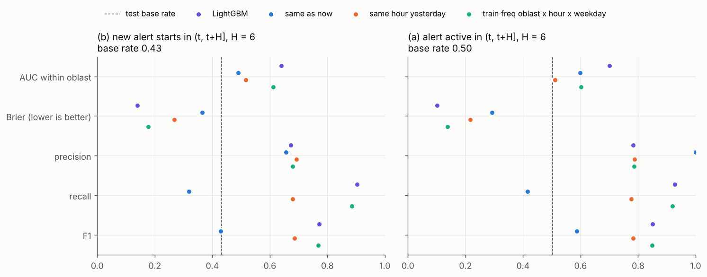
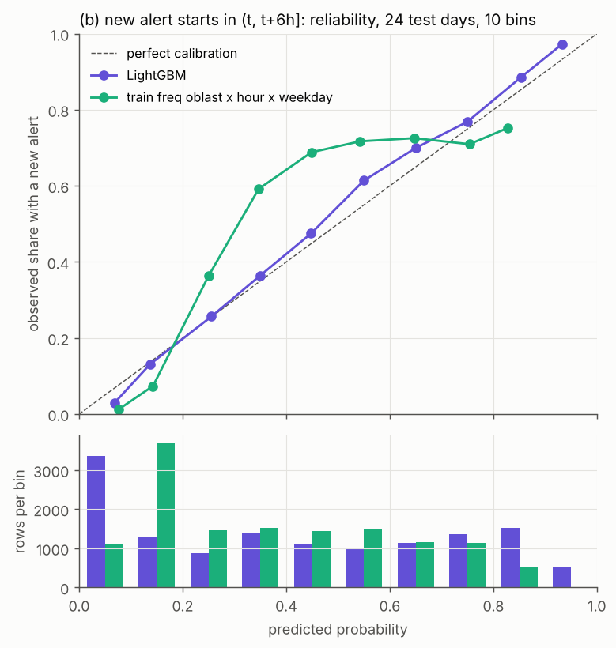
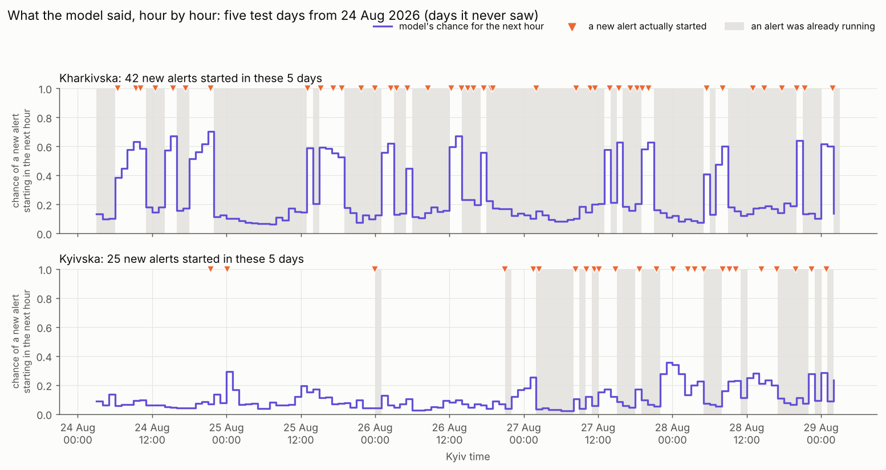

# Ukraine air-raid alerts: short-horizon forecasting by oblast

## What this is
Ukraine publishes the history of its air-raid alerts, region by region. This project uses that history to estimate, for every region and every hour, how likely it is that a **new** alert starts in the next 1, 3 or 6 hours. One model covers all 24 regions (23 oblasts and Kyiv city, called oblasts below), and at every forecast hour it uses only what was known at that hour. Every number is shown next to simple rules, such as "the usual rate for this oblast at this hour", so you can see where the model adds little. It is a course test task.

**The question.** At hour t, using only what is known at t: will a new alert start in oblast X within the next H hours, for H = 1, 3 and 6? The answer is a probability.

**Why new alerts, and not "is there an alert".** An hour with an alert in it is often just the current alert continuing: 67.5% of the "alert within 1 hour" cases already had an alert running at t (50.1% at H=3, 41.6% at H=6; `results/persistence_vs_target_a.md`). Answering that is mostly reading the present, so the part that has to be forecast is the new start.

## Results
New alert within H hours, test window of 24 days. Each cell is within-oblast AUC / Brier (see below):

| H (hours ahead) | Model | Train frequency | Same hour yesterday | Same as now | In words |
|---|---|---|---|---|---|
| 1 | 0.688 / 0.087 | 0.495 / 0.101 | 0.525 / 0.181 | 0.438 / 0.288 | Better than all three simple rules, on ranking and on probabilities. |
| 3 | 0.645 / 0.145 | 0.581 / 0.177 | 0.524 / 0.281 | 0.480 / 0.327 | Better than all three simple rules, on ranking and on probabilities. |
| 6 | 0.639 / 0.140 | 0.612 / 0.178 | 0.516 / 0.267 | 0.489 / 0.365 | Probabilities clearly better; the ranking edge over train frequency is small and not established (below). |

- **Within-oblast AUC** is how well the model ranks risky hours above quiet ones inside one oblast: 0.5 is a coin flip, 1.0 is perfect.
- **Brier** is how close the probabilities are to what happened: lower is better.
- **Data:** official alerts from Vadimkin/ukrainian-air-raid-sirens-dataset, upstream commit `7ccd436`, pulled 2026-10-10 (re-pulled 18:58 UTC, unchanged). The official feed ends 2026-09-07.
- **Test window:** the last 30 days of official data (2026-08-07 → 09-05), minus the Aug 29 – Sep 2 feed outage and Sep 3 (24h lookback). That leaves 24 days: the most recent official data we trust.
- **Data currency:** we re-derived the official data from its source channel and it matched (854 of 855 alerts in a 3-day check, 0 of 1,440 oblast-hours differ; `results/source_check.md`). The channel stopped on 2026-09-07 06:09 UTC, so no newer official data exists, and the test window ends Sep 5 because of that, not by our choice.
- **Same, Sep 4–5 alone (7-day features scaled from observed hours):** H=1 0.534 / 0.098 vs 0.466 / 0.119 · H=3 0.476 / 0.158 vs 0.424 / 0.218 · H=6 0.447 / 0.120 vs 0.409 / 0.203. Note: on Sep 4–5, same hour yesterday has a higher within-oblast AUC than LightGBM at H = 1, 3, 6.
- **Not established:** LightGBM's within-oblast edge over the frequency baseline at H=6. It wins in 13 of 24 oblasts on Aug 7–28 and 18 of 24 on all 24 days. Also not established: whether the Sep 4–5 drop comes from the scaled features or from the days themselves.
- **Telegram (separate experiment, not in the model above):** posts of the Air Force channel help only when they are minutes old, so they are a nowcasting signal, not a forecasting one; numbers next to the baselines in [News and text data](docs/DETAILS.md#news-and-text-data). The main model stays the full-history LightGBM without Telegram.

### Forward test on live data (a separate test, not mixed with the table above)
**Source: the Ukraine Alarm API, for every feature and every outcome.** The same frozen models (trained on official data to 2026-08-07; nothing refitted, nothing retuned, thresholds as before) scored on the 41 days 2026-09-07 to 10-17, 23,616 oblast-hours per horizon. It is a short test, so the intervals are wide. Within-oblast AUC / Brier:

| H | LightGBM | its AUC, 95% interval over days | Train frequency | Same hour yesterday | Same as now |
|---|---|---|---|---|---|
| 1 | 0.708 / 0.119 | 0.708 (0.677–0.731) | 0.531 / 0.152 | 0.515 / 0.255 | 0.407 / 0.400 |
| 3 | 0.662 / 0.167 | 0.662 (0.622–0.691) | 0.522 / 0.259 | 0.532 / 0.323 | 0.459 / 0.429 |
| 6 | 0.654 / 0.143 | 0.654 (0.610–0.689) | 0.519 / 0.256 | 0.536 / 0.264 | 0.475 / 0.445 |

- In this period the model is ahead of every simple rule on both AUC and Brier, and the day-resampling intervals of the differences stay on the model's side (for example against train frequency: AUC 0.177 [0.140, 0.210] at H=1, 0.135 [0.090, 0.170] at H=6). The old test's "not established" at H=6 stands for that test; this is one more period, not a replacement.
- New alerts were more frequent than in the old test, and the models, fixed on the quieter data, predict a little low: mean predicted against observed 0.1516 against 0.1796 at H=1, 0.3681 against 0.4143 at H=3, 0.5315 against 0.5711 at H=6. Details, the extra baselines, the Brier split and a run with the official outage mask: [DETAILS](docs/DETAILS.md#forward-test-on-the-ukraine-alarm-api), [results/forward_api/](results/forward_api/).



Look at the left panel (the question of this project: a new alert within 6 hours). On Brier, lower is better, and the purple LightGBM dot is clearly the furthest left; on AUC it is only slightly right of the green frequency dot, which is the edge listed above as not established. The right panel is the other target (any alert in the window), which is not the question.



Look at how close each line is to the dashed diagonal: on the diagonal, "40%" means a new alert followed in about 40% of those hours. The purple model stays near it; the green frequency rule is clearly off in the middle. The bars below count the hours in each bin.

## Quick start
```bash
git clone https://github.com/maranferij-lang/Ukraine-air-alerts
cd Ukraine-air-alerts
python3 -m venv .venv
source .venv/bin/activate
pip install -r requirements.txt
python scripts/plot_weekly.py
python scripts/evaluate.py
python scripts/plot_timeline.py
```
- `pip install` takes about 30 s. `plot_weekly.py` takes about 10 s and writes `figures/alerts_per_week.png`. `evaluate.py` takes about 1.5 min and writes the tables in `results/`, the pictures in `figures/` and the fitted models in `models/` (not committed), then prints a short summary in plain words and where to look. Optional, the last line of the block: `plot_timeline.py` takes about 10 s, reads the models `evaluate.py` saved, and writes `figures/forecast_timeline.png` (and the numbers behind it); it changes nothing in `results/`.
- **macOS only**, once, before `pip install` (without it, importing lightgbm crashes):

```bash
brew install libomp
```
- **Windows:** activate with `.venv\Scripts\activate` instead of the `source` line, and run the lines one at a time.
- Every block here can be pasted as it is, also into zsh (the macOS default), which does not accept comments in pasted lines. That is why the blocks have none.
- No download is needed: the data is in the repo (alerts in `data/raw/`, upstream commit `7ccd436`; hourly GDELT counts in `data/news/`; Telegram posts in `data/telegram/`). `scripts/fetch_*.py` only re-pull it and need network.
- **Optional**, each on its own:

```bash
python scripts/evaluate_news.py
python scripts/evaluate_telegram.py
python scripts/check_no_peeking.py
```
- `evaluate_news.py` takes about 2 min and rebuilds `results/news/`; `evaluate_telegram.py` takes about 3 min and rebuilds `results/telegram/`; `check_no_peeking.py` takes about 25 s and prints the leakage check.
- **Tested** on Linux from a fresh clone and a fresh venv: Python 3.11, 3.12 and 3.13 (pandas 3.0.6, numpy 2.4–2.5, matplotlib 3.11.2, lightgbm 4.7.0) and Python 3.9 (pandas 2.3.3, numpy 2.0.2, matplotlib 3.9.4, lightgbm 4.6.0); on a Mac with Python 3.9 every number matched. The Telegram line was run on Python 3.13 and 3.9 only.
- **Tables in `results/` are byte-identical across the machines we tried. Figures can differ slightly (fonts, matplotlib version): on Python 3.9 the four PNGs differ by a few pixels, the numbers behind them do not.**

## Try it: what did the model say at a past hour?
```bash
python scripts/predict.py --at "2026-09-05 14:00" --oblast Kharkivska
```
```text
Kharkivska, 17:00 Kyiv time on 5 Sep: 51% chance a new alert starts within 1 hour, 87% within 3, 96%
within 6. It did start, 22 minutes later.

new alert within model  same as now  same hour yesterday train frequency happened
             1 h 0.505            0                    0           0.193      yes
             3 h 0.872            0                    1           0.474      yes
             6 h 0.961            0                    1           0.794      yes
```
- **The first line is the answer in words** (the time is Kyiv time; `--at` is UTC unless you add an offset such as `+03:00`). The table under it has the same probabilities next to the three simple rules and what happened. "happened" is yes in all three windows.
- The model only sees what was known at that hour. For any hour before 2026-08-07 the model was trained on that period, so the output says so: it is not a forecast.
- Other forms: `--all` instead of `--oblast` gives every oblast in one table; `--at "2026-09-05 17:00+03:00"` writes the same hour in Kyiv time. Oblast names are as in the data, without "oblast", in any case, or any unique start: `Kharkivska`, `Kyiv City`, `Lviv` (`Kyiv` alone is ambiguous). Any hour from 2022-03-16 to 2026-09-05 is allowed.
- `--now` instead of `--at` checks the official channel for newer data. Today there is none (the channel stopped on 2026-09-07), so it says so in one sentence and shows the forecast for the latest hour we have, 2026-09-05 23:00 UTC, labelled as not now. If the channel cannot be reached it says that instead. There is no other fallback.
- It needs `models/`, which `evaluate.py` writes; without them it says to run `evaluate.py` first. Files land in the repo folder: tables in `results/`, pictures in `figures/`, models in `models/`.
- `evaluate.py --verbose` also prints every table; they are all in `results/` anyway.



This is `scripts/plot_timeline.py` on the saved H = 1 model, for 24–28 Aug 2026 (UTC days, shown in Kyiv time). It is the five-day window of Aug 7–28 with the most alert starts in the less active of the two, so both oblasts have plenty: Kharkivska 42 new alerts, Kyivska (the oblast around Kyiv) 25. The purple line is the model's chance for the next hour; the orange triangles are new alerts that really started; grey is an alert already running. Look at the line next to the triangles: it is low while an alert is already running, because only new starts count, and higher in the quiet gaps between alerts.

## How this was built
Claude Code, an AI coding assistant, wrote the code. The rules are in `CLAUDE.md`; the project owner wrote them, set the task of every round, and checked the numbers by hand each time. Every step, decision and mistake is in `PROCESS_LOG.md`. The full AI conversation log is submitted separately.

The rules (fixed):
- No leakage. Every feature for origin t uses only what is known at t. Neighbours use the last completed hour [t−1h, t). Static tables (the frequency baseline) are fitted on train only; rolling features may use anything already observed by t. Splits are chronological, never random.
- Every model number is shown next to three simple rules. If the model doesn't beat them, we say so.
- Metrics: Brier, **ROC-AUC within oblast** (main number), precision/recall at a threshold. No plain accuracy.

Where the checks caught mistakes:
- **The volunteer feed mislabels Lviv and Volyn:** a substring bug in its parser, upstream. We found it when the volunteer and official feeds disagreed, and we never compare western oblasts with volunteer numbers.
- **Two leaks in the original model spec:** a frequency table "from the last 4 weeks of train" contains each row's own outcome, or a future one (now a rolling average of the same hour 1–4 weeks earlier); and the F1 threshold was to be picked on a week the model had been trained on (now picked with a model that did not see it).
- **A shrunk test window:** a feature quietly cut the test window from 30 to 22 days and only the log said so. The rule is to ask first; it was fixed, and the window is now 24 usable days.
- **News made the model worse:** the GDELT news count lowered the ranking at H=1 and H=3, probably because a national count acts as a calendar. It is merged as a documented negative result.
- **This README's first quick start broke on a Mac:** zsh does not treat `#` as a comment in pasted lines, so nothing ran. All code blocks are now comment-free and were pasted into zsh to test them.

## Limitations
- **Western oblasts:** Lviv, Ivano-Frankivsk and Zakarpattia had one new alert each in the 24 test days. Their within-oblast AUCs are close to noise.
- **Sep 4–5:** two days with 7-day features scaled from the observed hours. Every predictor scores lower there, and two days can't say why.
- **The official feed stopped on 2026-09-07,** so the test window ends a month before the pull and there is no "now".
- **The official feed misses one wave inside the old test window:** on Aug 19–20 the Ukraine Alarm API shows alerts in Chernihivska and Kyivska oblast (about 10–13 hours) that our official data does not have, 25 oblast-hours in all (found by comparing the two, [results/api_check.md](results/api_check.md)). The old test and the data are unchanged. Putting those hours back moves the model's within-oblast AUC by +0.0031, +0.0014 and +0.0002 at H = 1, 3, 6 and its Brier by 0.0000, 0.0000 and −0.0002 ([results/aug19_sensitivity.md](results/aug19_sensitivity.md)).
- **The raion switch (Jul–Dec 2025)** changed what an alert means; the half-of-raions rule keeps base rates roughly continuous for most oblasts but not all (Kherson).
- **Thresholds** come from a validation fit on train minus the last week, not from the model scored on test.

The full list, what we would do next, and everything else moved out of this page (data, targets, model, the news and Telegram experiments, run order, definitions, layout) are in [docs/DETAILS.md](docs/DETAILS.md): [Data](docs/DETAILS.md#data), [Targets, baselines, evaluation](docs/DETAILS.md#targets-baselines-evaluation-scriptsevaluatepy), [Model](docs/DETAILS.md#model-scriptsevaluatepy-srcfeaturespy), [News and text data](docs/DETAILS.md#news-and-text-data), [Limitations](docs/DETAILS.md#limitations-and-what-we-would-do-next), [Run order](docs/DETAILS.md#run-order), [Definitions](docs/DETAILS.md#definitions), [Layout](docs/DETAILS.md#layout).

Status: final on main (round 13); this branch adds round 14, the forward test on API data. Files to open first: `results/test_table.md`, `figures/model_vs_baselines_h6.png`, `PROCESS_LOG.md`.
